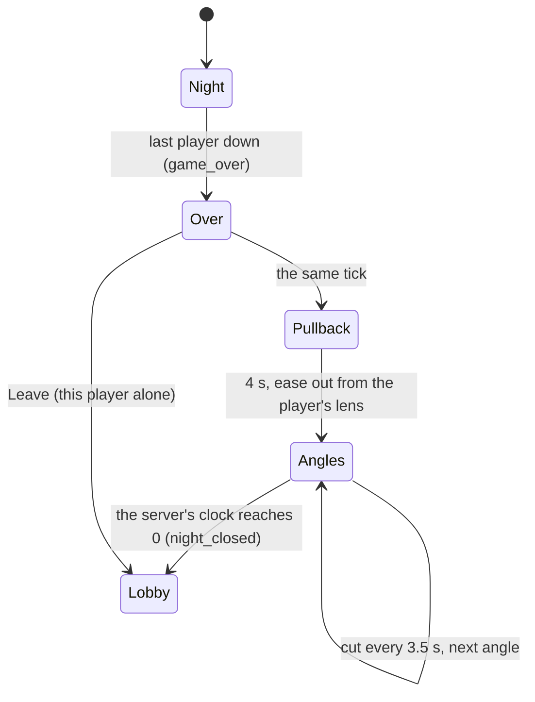

# The end of a night

What happens from the moment the last player goes down until everyone is standing in the lobby again (Deadnight #973).
The maintainer's words, 2026-11-04: *"Whenever the game ends. It simply says 'you did not make it' and shows the
round and points earned. that's nice, but we should follow a call of duty style where it has a cinematic overview of
the map (different camera angles as it zooms out slowly from a starting point from the current camera angle) while
showing the scoreboard for all players and then intermissions for about 15 seconds before going back to the lobby. The
lobby should retain itself basically."*

The genre is the reference for **feel only**. The camera moves, the board and the words are ours.

## How the genre stages its end

What the public sources say (the research and what we took from it: [research](../research/end-of-night.md)):

| Beat | What the genre does | What we do |
| --- | --- | --- |
| The last moment | A short collapse or "eliminated" beat before the cut (Black Ops 6 Zombies has a third-person collapse; older ones put the text on a still world). | The night stops where it stands (nobody moves, the dead stand), the title falls in at once: **YOU DID NOT MAKE IT**. |
| The camera | The view leaves the player and gives an overview of the place: a slow pull-back, then a few cuts between set angles (the multiplayer's final killcam and best play are the same idea: a camera that is not the player's, set up to be looked at). | A slow pull-back from **each player's own camera** up and out over the lot, then **cuts** between a few authored angles per map. Slow, never faster than a walk of the eye. |
| The numbers | A results table of the whole team over the picture (rounds survived in the title, then a row for each player). | The scoreboard for **every** player over the picture, the room's round in the title. |
| The wait | An intermission with a clock, then the lobby (the party kept). | **About 15 s** with a countdown, then the same lobby: host, people, bots, map and settings. |

## The sequence

1. **Over (0 s).** The server freezes the night (no more steps of the dead, the bodies or the rules; the lot is a
   still picture) and starts the **intermission clock**: 15 s, an `over_left` in every frame, whole seconds. The clock
   is the server's, so every client counts the same seconds whatever its own frame rate or link.
2. **Pull-back (0 to 4 s).** The camera starts at this player's lens (position, orientation and field of view) and
   eases out to a high place behind the player, looking at where the player fell. It is eased at both ends
   (`smoothstep`), so it has no first-frame jerk. The place is the farthest of several ways (straight back and up, or
   turned, or lower) that the walls leave: in the open the full pull, under a low ceiling a way along the room.
3. **Angles (from 4 s).** Cuts, one every 3.5 s, between the map's authored shots (three in the 11 s that are left);
   each shot is a slow drift (a start and an end position and a look point that drifts too) so no picture is still.
   Each is a cut, not a blend: the genre cuts. Players do not all see the same angle first (the seat picks it).
4. **The board.** Over all of it: the title, *Round N reached* and the night's clock on the left, a ticket on the right
   with a row for each seat in order of points: name, points, kills, headshots (kills by a shot to the head), downs,
   revives, rounds (the rounds the player stood at the end of). A dark band at the top and the bottom keeps the words
   readable over any picture. A player who leaves later keeps their row.
5. **The clock.** *Back to the lobby in 12* under the board, with **Leave** beside it.
6. **Back.** At 0 the server says `night_closed`; every client closes its link and opens the lobby it came from
   (online) or its Play screen (alone).

## Authored angles

Each map has `end_shots` (a list of `EndShot`): where the lens starts, where it ends, what it looks at, the field of
view. They are written in the map's resource, in metres of the map, and a test checks every shot: the lens is
never inside a wall or solid prop along its whole drift (a swept ray from each start to each end and from the lens to
its look point), is above the floor, and looks at something (the look point is inside the map's bounds). The two maps:

- **The lot** (drive-in), four angles from high above it: the whole lot from over the ticket plaza with the screen
  and the beam at the end of it; the cars and the screen from over the west fence; the generator yard from over the east
  fence; the midway and the beam from over the concession.
- **The back rooms**, four angles inside the rooms, lens just under the ceiling (the shell is closed and dark from
  outside, so an outside shot shows nothing): the hall along its east wall, the hall along its west wall, the
  rewind room from its west end, and the rewind room from its east end.

Exact numbers: [research](../research/end-of-night.md#the-shots) and the maps' resources.

## Online

- The **server owns the end.** It freezes at `game_over`, counts the 15 s, sends `night_closed` once, then drops
  whoever has not left within 3 s and closes the room.
- A client **stays connected** through the intermission (the frames carry the clock and the final picture) and
  closes its link at `night_closed`, or when its player presses Leave.
- A player who **leaves during it** (Leave, or a closed tab) frees their seat without touching the sequence: the
  others' clocks and return are unchanged; the leaver also leaves the lobby, so the host role passes on.
- On `night_closed` the server tells the backend the match **finished** with the users still present; the backend
  **reopens the lobby** instead of dropping it: the same code, host, settings (map, bots, rules) and the people who
  were present. Each client then asks the backend for its lobby and opens the lobby screen.

## Alone

Alone and over a loopback, the same server runs in the client's process and the same clock counts. At 0 the night
screen goes back to the Play screen it came from, whose settings (map, bots, rules) are as the player left them.

## Phone

The board fills the width on a phone held sideways (844 x 390 and 2340 x 1080 canvases), the touch controls go away,
the rows shrink to fit the height, and Leave is a large target on the right.
