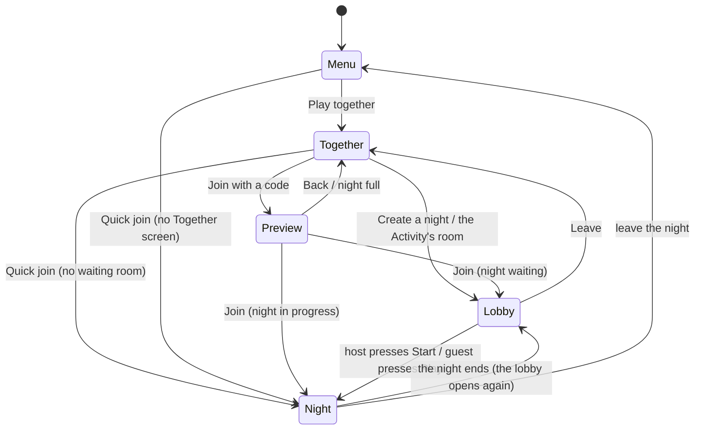

# The lobby

Where friends gather before a night: who is here, who hosts, when it starts, and what a latecomer sees. It answers the
maintainer's questions of 2026-11-02 ("are players able to join mid match, or no?", "it's kind of difficult to know if
players are in your lobby before you start"; Deadnight #515). The platform side (endpoints, expiry) is in
[the platform backend](../research/platform-backend.md#the-lobby-before-the-night); the networking decision is in
[networking](networking.md).

**Status:** built and played in the browser: the backend (open and started lobbies, presence, the round, the
preview by code), the lobby screen and its poll (`LobbyScreen`, `LobbyWatch`), Play together
opening it, the join notice in the night, and a web probe (`tools/web_smoke/lobby.py`). Not built: the host's match
settings are built too (the host's `MatchSettingsPanel`, sent live with `PUT /lobbies/:id/settings`, read only for
guests).

## The rules in one place

- A **lobby** has a short code, up to **8 seats** for people (`NightHost.MAX_PLAYERS`; the bots the host sets hold no
  seat and are never counted, #1179), one **host** (the first seat) and a status: **open** (waiting for the host) or
  **started** (a night is running, with a round).
- A night is **public or private**. A new night is **public**: it is in the Server Browser's list (below) and Quick join
  may seat a stranger in it. Its host can make it **private** (`PUT /lobbies/:id/visibility`, at any time, in progress
  too); a private night is in no list, and its code still joins it. The host's lobby has a **Private night** switch (below),
  off by default; whether a night is public until then is one constant, `TogetherApi.PUBLIC_BY_DEFAULT`, which the
  game sends when it makes the night (the maintainer has not yet confirmed public is the right default, #1186).
- **Only the host starts.** Guests wait and can leave.
- **Late joining stays on.** A started night takes newcomers while the game server has room (the same 8). The code says
  *Night in progress, round N* before the newcomer presses Join, and Join goes straight in.
- The lobby screen **polls** the backend every 2 seconds. A member who has not polled for a minute has left (a closed
  tab never says so), while someone else is still there; the host role passes on.
- A player is in **one lobby at a time**, and creating, joining or Quick joining another **moves** them; nobody is told
  they are in another night ([every state and what ends it](#leaving-and-moving-every-state-and-what-ends-it)).
- A player never sees an address, an id or a port: only names, seats, a code and a link.

## The flow, screen by screen

When a night ends it does not drop its lobby: after the intermission everyone is back in the same lobby, with its code,
its host, its seats (the people who were still there), its map, bots and rules, ready for the host to start again
([the end of a night](end-of-night.md#online)).

### 1. Create a night (the host)

Together has the three ways in it already: *Quick join*, *Create a night*, *Join with the code*. *Create a night* no
longer starts the night. It opens the **lobby** with the player as host:

- The code in large type and the invite link (the web), with *Copy the link* and *Copy the code*.
- **Seats**: eight rows, `1 Ann  HOST`, `2 (open)`, `3 (open)`, ... `8 (open)`. The host's Bots setting shows as bots
  in the highest open seats, `8 Ash  BOT`, `7 Fern  BOT`, never more than the seats people leave free; a person who
  joins takes one of them ([the rules](rounds.md#bots)). A name is as long as the backend has it (guest names, Discord
  names; #485 will make them the player's own).
- **The night's rules** (`MatchSettingsPanel`, shared with the Play screen): zombie intensity, most alive at once,
  break between rounds, bots. Only the host's panel moves; guests see the same values, read only, as the host sets them.
  A change goes to the backend a third of a second after the host stops (`PUT /lobbies/:id/settings`, one request
  at a time, the last change wins) and reaches the others on their next poll (within two seconds). Start sends the
  panel's values with it, so a change still waiting is never lost. A host who leaves hands the panel on with the
  rules the lobby holds. Once the night starts the panel is read only for everyone (`409 already_started`).
- **Private night** (a switch after the rules, so it is on screen with Start: the lobby opens scrolled to the button
  the host presses). Off is a public night, in the Server Browser; on, only the code gets in. The host's press goes
  to the backend at once (`PUT /lobbies/:id/visibility`, one request at a time, the last press wins, Start waits for
  it) and works from the keyboard, a gamepad and a finger (a 62 unit row, a tap target); it stays the host's after the
  start. A guest sees the same switch, read only, and is told when the host moves it (*Ann made the night private.*)
  on their next poll. A backend that says nothing of `visibility` shows no switch.
- **Start the night** (primary, focused) and **Leave** (ghost). A line under the seats says what is going on:
  *Waiting for friends. Send them the code.*

### 2. Wait and see members (everyone)

Rows appear and disappear within two seconds of someone joining or leaving. A member whose screen has gone quiet for
15 s shows *(away)*. The status line reads:

- host: *1 of 4 here. Start whenever you are ready.* (Start works alone: it is the old behaviour, one press later);
- guest: *Waiting for Ann to start the night.* Leave is the only button, and the settings are read only.

### 3. Start (the host)

*Start the night* sends the rules (once: they are fixed from then on), the backend allocates a game server, and the host
goes in at once with a ticket. If every server is busy the lobby stays open and says *All the servers are busy. Try
again in a minute.* A guest's poll sees `started`; the status line changes to *Ann started the night* and **Play**
becomes the primary button. A guest presses it (on the web a click is also what lets the page lock the mouse and play
sound, which is why a guest is not walked in without one) and gets a ticket.

### 4. Join late

A friend with a code (typed, or from `?room=CODE`, or the Activity's room) first sees a **preview**, joined to nothing,
which keeps reading the code every two seconds while the screen is open (a waiting room becomes *Night in progress*
by itself):

- *Waiting room, Ann hosting, 2 of 4.* with **Join**;
- *Night in progress, round 4, 2 of 4 here.* with **Join** (a late joiner goes straight into the night);
- *That night is full (4 of 4).* with **Back** only.

Join then adds the player (`join-by-code`) and, for a night in progress, takes a ticket and enters. In the night the
others read *<NAME> JOINED* in the notices under the event feed and see the new row on the scoreboard (Tab).

### 5. Leave

*Leave* on the lobby screen, or Back, tells the backend (`leave`), and the screen returns to Together. A player who
closes the tab is dropped after the minute above. Someone who comes back after being dropped is told *You were away
for too long, so the room moved on* and offered Back, never a silent empty lobby.

### 6. The host leaves

Before the start the next seat becomes host: the rows renumber, the `HOST` mark moves, that player's panel becomes
editable and their button reads *Start the night*, with the line *Ann left. You are the host now.* The last player out
closes the lobby. After the start the host role has no job: the night belongs to the game server.

### 7. A full room

The fifth player gets *That night is full (4 of 4).* at the preview, or, if the room filled between preview and Join,
the same message from the refusal (`409 full`). Nobody is queued: Back, or Create a night of their own.

### 8. In the Discord Activity

The Activity plays the website's Play together, nothing more (#1178). It opens on the main menu (#495) and signs in with
Discord in the background (`StartupSignIn`); Play together is the same screen with Quick join, Create a night and the
code field, and makes no lobby until the player presses Create. Players reach each other by the code, the link or Quick
join, like on the website: the voice channel's instance id is not sent to the backend and names no lobby (it used to,
and two players who each pressed Play together got a lobby of their own). Share in Discord and the invite window stay.

## Leaving and moving: every state, and what ends it

The rule (Deadnight #1177, the maintainer: *"we need this streamlined and fixed with a seamless experience in being able
to easily jump between lobbies"*): a player is in **one lobby at a time, open or started**, and **create, join and Quick
join move them**: they take the player out of the lobby they were in, and a player is never refused for being somewhere
else (there is no `already_in_lobby` any more). A lobby with **no person** in it (bots do not count) is gone at once,
with its code, its seats and its match. Every normal way out ends the state at once; the timers below are only the
backstop for a client that vanished without a word.

### The states of a lobby

| State | What it holds | Ends when | Backstop |
| --- | --- | --- | --- |
| **Open** (waiting room) | code, seats, host, the host's rules | the last member leaves, or moves to another lobby (at once); the host starts it (it becomes **Started**) | 10 minutes without a poll; a member quiet for a minute is dropped while another is still there |
| **Started** (a night) | the match on a game server, the members, the round | the last member leaves or moves (at once); the game server says the last person's seat is empty (`POST /internal/matches/:id/left`); the game server says the match is over (`/end`, at once when the last person leaves the room, bots or not); a finished night reopens it | the heartbeat stops listing the match (5 minute grace), 2 hours of age |
| **Reopened** (a finished night's waiting room) | the same code, host and rules, the people who were still in the room | a member reads it (it is an **Open** one from then on); the last member leaves or moves | nobody reads it within a minute (the night screen asks every half second for 10 s), so nobody is coming back to it |
| **Gone** | nothing: no code, no members, no match, no slot | | |

### The states of a player

| State | Ends when (and what the player can do next) |
| --- | --- |
| **Menu** (in no lobby) | create, join or Quick join puts them in a lobby |
| **Waiting room** (member of an open lobby) | Leave, Back or Esc (`leave`, from `LobbyScreen._exit_tree`); the host's Start (to **Night**); create, join or Quick join elsewhere (moves them); a minute without polling while another member is there (dropped; their next poll says `not_member`) |
| **Night** (member of a started lobby, connected) | *Leave night* in the Esc menu and the end board's *Leave* (`NightScreen._go_back`: `leave`, then the socket closes); a closed tab or an Activity that closed (the browser closes the socket with code 1001, an abrupt close is a dropped connection; the game server frees the seat and says so, `user_left`); create, join or Quick join elsewhere (moves them); the night ends (to **Reopened**) |
| **Away** (the socket dropped, not on purpose) | they come back with their token inside 30 s, or the seat is freed and the game server says so; create, join or Quick join elsewhere moves them at once |
| **End-of-night intermission** | Leave, a closed tab (as above), or the server's clock: the room says `finished` with who was still there, and the lobby reopens for them |
| **Reopened lobby** (member of a lobby they may never see) | read it on the lobby screen; or create, join or Quick join elsewhere (moves them); a minute unread and it is gone |

### Every way out, once

| Way out | What happens | At once? |
| --- | --- | --- |
| Leave / Back / Esc on the waiting room | `leave`; host role passes on; an empty lobby is gone | yes |
| *Leave night* (Esc menu) | `leave`, then the socket closes; the room frees the seat (a room with only bots ends and tells the backend) | yes |
| End board's *Leave* | the same | yes |
| Closing the tab or the Activity during a night | socket 1001 (an abrupt close is the row below), seat freed, `/left` to the backend, the lobby loses the member (or goes with the last one) | yes |
| A dropped connection | the seat is held 30 s for a resume (a person may come back), then freed and `/left` | after the resume window |
| A night that ended | `/end` with `finished` and who was in the room: the lobby reopens for them | yes |
| Closing the tab on the waiting room, alone | the backend hears nothing (no beacon is sent), so the lobby waits for its backstop | no, 10 minutes; but the player is not held by it |
| Create, join or Quick join from anywhere | takes the player out of the lobby they were in first (a join refused as `full` leaves them where they were) | yes |

### What was wrong

The maintainer's report: leaving a match and trying to join another said *You are in another night already*, and the
lobby he left had bots in it. The causes, each reproduced first by `game/tests/net/test_leaving_a_night_online.gd` (a
real `GameServer` and the real backend) and `spikes/backend/test/moving.test.ts`:

1. **A reopened lobby held the people it was opened for.** A finished night reopened its lobby and put every present
   user back in the "one open lobby per user" index. The player who had gone to the menu, or whose screen gave up
   waiting after 10 s, or whose tab was closed, never read it, so every create and join said `already_in_lobby` until the
   10-minute idle timer. A solo night with bots is the one whose reopened lobby only the leaver is in, so nobody else
   polls it and nothing drops it early: that is why the report mentions the bots. Now a player is never refused, and an
   unread reopened lobby is gone within a minute.
2. **The Esc menu's *Leave night* only popped the screen.** It never said `leave`, so the player stayed a member of the
   started lobby, and Quick join (which returns the public night you are a member of) could hand it back.
3. **Nothing told the backend that a seat in a started night was empty.** A player who closed the tab or was kicked
   stayed in the member list of a night with others in it, for the whole night. The game server now says so.

Ruled out by the same tests: **a room with only bots does end at once** (`NightHost` frees the seat on a clean close,
the room empties, `_end_room` posts `/end`, and the lobby is dropped), and leaving with the button or closing the tab and
then creating, joining or Quick joining a night all worked before the fix, so "bots do not count as empty" was not a
cause.

### Not covered

A sole member who **closes the tab on the waiting room** sends nothing (a `pagehide` request with an `Authorization`
header cannot be proven reliable across browsers and Discord's proxy from here), so that lobby waits for its 10-minute
backstop. It holds nobody, but a lobby list would show it until then; if that matters, the fix is a beacon on `pagehide`,
not a shorter timer (a host who goes to a chat to paste the invite is quiet for minutes).

## Poll or push

**Polling.** `GET /lobbies/:id` every 2 s while the lobby screen is up, and nothing at other times.

- *Discord's proxy and the web.* A poll is a plain HTTPS request on the path that already works (the `/api` mapping,
  gzip answers, `accept_gzip = false`). A push channel is a second WebSocket through the same proxy, with its own
  reconnection, its own auth and a way to be wrong that polls do not have.
- *Cost.* A lobby has at most 8 members, an answer is about 700 bytes: eight screens use 4 requests a second, and a poll
  is also the member's heartbeat, which gives presence for free.
- *Latency.* A join shows within 2 s. For a waiting room that is as good as instant; the start is also seen within 2 s,
  which the guests' *Play* press hides.
- *The way out.* If lobbies ever hold hundreds of waiting players, long polling (the same URL held open until the
  revision changes) cuts the delay without changing the shape. Not needed now.

A background tab stops the game's frames, and with them the polls (a browser throttles hidden pages). A host who goes
to a chat to paste the invite is therefore quiet for a while: the presence window is a minute, and a host who is alone
is never dropped for it (the lobby expires after ten idle minutes, as before).

## Quick join from the menu

Pressing *Quick join* on the Play tab (Deadnight #526) does not open the Play together screen. A card
(`QuickJoinOverlay`) opens over the menu and does what the Together screen's Quick join does, with the same calls:
sign in (once), `POST /lobbies/quick`, `POST /lobbies/:id/ticket`, then the night.

- **While it searches** the card says *Finding a night...* with **Cancel** (Esc or the pad's B does the same). A search
  cancelled after the backend had put the player in a night leaves that night, so nobody holds a seat for a player who is
  on the menu. Quick join pressed again while it searches is the same search.
- **The map of the night it found** shows as a ticket under the line (`MapCard`, from the lobby's `settings.map` or
  `map`) until the night opens: the lot today, and the host's choice once there is another map
  ([maps](maps.md#where-else-the-map-shows)).
- **No name is asked** on this path. The saved name is used, else the backend calls the player `Guest NNNN`; the name is
  set under More. (The Play together screen still asks on its first use.)
- **If no night is found or the call fails** the card says the same words as the Together screen (`TogetherApi.TEXTS`) and
  offers **Create a night** (a lobby of the player's own, opened on its lobby screen with the code) and **Close**.
  The Together screen is therefore never in the path.
- In a **Discord Activity** the card asks as above: its sign-in is the one the menu started (`StartupSignIn`), which
  the card waits for if it is still out.
- Proof: `game/tests/ui/test_quick_join.gd` (found, failed and cancelled paths with a stubbed `TogetherApi`, and a
  press that lands in a joined room over a real socket) and the browser probe `tools/web_smoke/quick_join.py`.

## The list of nights (the Server Browser's data, #1179)

`GET /lobbies` (signed in; `TogetherApi.list_nights`) lists the **public** nights a player can be shown to join: waiting
or in progress, with room first, then the most people, then the newest, at most 50 (`total` says how many there are).
The list carries both **lobbies** that still wait and **matches** in progress (the maintainer: "server browsers should
show both lobbies and existing matches"). A row is
`{id, code, map, hostName, players, maxPlayers, bots, kind, state, round, full}`:

- `players` is **people only**, out of `maxPlayers` (8): a bot holds no seat, so it is in `bots` (what the host set), never
  in `players`. A waiting night counts its lobby's members; a started one the game server's own count from its heartbeat
  (the people who hold a seat, one whose socket dropped included).
- `kind` says which it is: `lobby` (waiting for its host, `state` `open`, `round` null) or `match` (in progress, `state`
  `started`, with the `round` the game server last said; null until it has said one).
  `full` is no room for another person; a full night is listed last, so a screen can show it greyed.
- `map` is the map's id; the game knows its name and its picture. `code` joins: `POST /lobbies/join-by-code` with the
  row's code is the Join of a row (it works on a night in progress).
- A night that ended, whose last person left, or that ran out of time is gone from the very next call (the list reads
  the lobbies as they are and keeps nothing between calls), and a member who stopped polling is not counted.
- It is polled, so it is **limited**: 20 asks in 10 seconds for one account, then `429 too_many_requests` with a
  `Retry-After`. A screen polling every 3 to 5 seconds, with a Refresh button, stays well inside it.

The screen that draws it is the Server Browser (#1180); until it lands, Quick join and the Together screen are the
ways in.

## What is not in this

- **Quick join** (from the menu or the Together screen) has no waiting room: it puts a stranger in a public night with
  room, or starts a new one. A public waiting room strangers fill up is a separate decision (it needs a countdown or a
  minimum, and someone to be host).
- **Kicking** a member, **ready** checks and **chat** are not built.
- **Changing the rules after the start** is not possible: they are fixed when the night begins.
