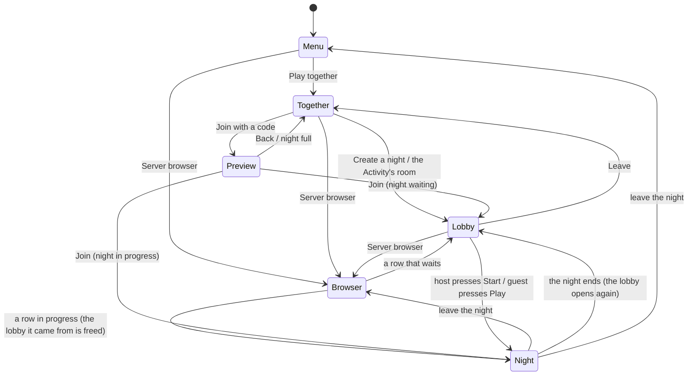

# The lobby

Where friends gather before a night: who is here, who hosts, when it starts, and what a latecomer sees. It answers the
maintainer's questions of 2026-11-02 ("are players able to join mid match, or no?", "it's kind of difficult to know if
players are in your lobby before you start"; Deadnight #515). The platform side (endpoints, expiry) is in
[the platform backend](../research/platform-backend.md#the-lobby-before-the-night); the networking decision is in
[networking](networking.md).

**Status:** built and played in the browser: the backend (open and started lobbies, presence, the round, the
preview by code), the lobby screen and its poll (`LobbyScreen`, `LobbyWatch`), Play together
opening it, the join notice in the night, a web probe (`tools/web_smoke/lobby.py`), the host's match settings (the
host's `MatchSettingsPanel`, sent live with `PUT /lobbies/:id/settings`, read only for guests) and the Server Browser,
the list of public nights (below; `tools/web_smoke/server_browser.py`).

## The rules in one place

- A **lobby** has a short code, up to **8 seats** for people (`NightHost.MAX_PLAYERS`; the bots the host sets hold no
  seat and are never counted, #1179), one **host** (the first seat) and a status: **open** (waiting for the host) or
  **started** (a night is running, with a round).
- A night is **public or private**. A new night is **public**: it is in the Server Browser's list (below), where any
  player can join it, and Quick join may seat a stranger in it. Its host can make it **private**
  (`PUT /lobbies/:id/visibility`, at any time, in progress too); a private night is in no list, and its code still
  joins it. The host's lobby has a **Private night** switch (below), off by default; whether a night is public until
  then is one constant, `TogetherApi.PUBLIC_BY_DEFAULT`, which the game sends when it makes the night (the maintainer
  has not yet confirmed public is the right default, #1186).
- **Only the host starts.** Guests wait and can leave.
- **Late joining stays on.** A started night takes newcomers while the game server has room (the same 8). The code says
  *Night in progress, round N* before the newcomer presses Join, and Join goes straight in.
- The lobby screen **polls** the backend every 2 seconds. A member who has not polled for a minute has left (a closed
  tab never says so), while someone else is still there; the host role passes on.
- A player is in **one lobby at a time**, and creating or joining another **moves** them; nobody is told
  they are in another night ([every state and what ends it](#leaving-and-moving-every-state-and-what-ends-it)).
- A player never sees an address, an id or a port: only names, seats, a code and a link.

## The flow, screen by screen

When a night ends it does not drop its lobby: after the intermission everyone is back in the same lobby, with its code,
its host, its seats (the people who were still there), its map, bots and rules, ready for the host to start again
([the end of a night](end-of-night.md#online)).

### 1. Create a night (the host)

Together has the three ways in it: the *Server browser*, *Create a night*, *Join with the code*. *Create a night* no
longer starts the night. It opens the **lobby** with the player as host:

- The code in large type and the invite link (the web), with *Copy the link* and *Copy the code*.
- **Seats**: eight rows, `1 Ann  HOST`, `2 (open)`, `3 (open)`, ... `8 (open)`. The host's Bots setting shows as bots
  in the highest open seats, `8 Ash  BOT`, `7 Fern  BOT`, never more than the seats people leave free; a person who
  joins takes one of them ([the rules](rounds.md#bots)). A name is as long as the backend has it (guest names, Discord
  names; #485 will make them the player's own).
- **The night's rules** (`MatchSettingsPanel`, shared with the Play screen): zombie intensity, most alive at once,
  break between rounds, bots. Only the host's panel moves; guests see the same values, read only, as the host sets them.
  A change goes to the backend a third of a second after the host stops (`PUT /lobbies/:id/settings`, one request
  at a time, the last change wins) and reaches the others on their next poll (within two seconds). Start sends the
  panel's values with it, so a change still waiting is never lost. A host who leaves hands the panel on with the
  rules the lobby holds. Once the night starts the panel is read only for everyone (`409 already_started`).
- **Private night** (a switch after the rules, so it is on screen with Start: the lobby opens scrolled to the button the
  host presses, and when the buttons below the row would push the switch out of the top of a phone page's area it is
  scrolled back to the row if Start still fits under it, `LobbyPrivateSwitch.reveal`). Off is a public night, in the
  Server Browser; on, only the code gets in. The host's press goes to the backend at once (`PUT
  /lobbies/:id/visibility`, one request at a time, the last press wins, Start waits for it) and works from the keyboard,
  a gamepad and a finger (a 64 unit row, a tap target); it stays the host's after the start. A guest sees the same
  switch, read only, and is told when the host moves it (*Ann made the night private.*) on their next poll. A backend
  that says nothing of `visibility` shows no switch.
- **Start the night** (primary, focused) and **Leave** (ghost). A line under the seats says what is going on:
  *Waiting for friends. Send them the code.*

### 2. Wait and see members (everyone)

Rows appear and disappear within two seconds of someone joining or leaving. A member whose screen has gone quiet for
15 s shows *(away)*. The status line reads:

- host: *1 of 4 here. Start whenever you are ready.* (Start works alone: it is the old behaviour, one press later);
- guest: *Waiting for Ann to start the night.* Leave is the only button, and the settings are read only.

### 3. Start (the host)

*Start the night* sends the rules (once: they are fixed from then on), the backend allocates a game server, and the host
goes in at once with a ticket. If every server is busy the lobby stays open and says *All the servers are busy. Try
again in a minute.* A guest's poll sees `started`; the status line changes to *Ann started the night* and **Play**
becomes the primary button. A guest presses it (on the web a click is also what lets the page lock the mouse and play
sound, which is why a guest is not walked in without one) and gets a ticket.

### 4. Join late

A friend with a code (typed, or from `?room=CODE`, or the Activity's room) first sees a **preview**, joined to nothing,
which keeps reading the code every two seconds while the screen is open (a waiting room becomes *Night in progress*
by itself):

- *Waiting room, Ann hosting, 2 of 4.* with **Join**;
- *Night in progress, round 4, 2 of 4 here.* with **Join** (a late joiner goes straight into the night);
- *That night is full (4 of 4).* with **Back** only.

Join then adds the player (`join-by-code`) and, for a night in progress, takes a ticket and enters. In the night the
others read *<NAME> JOINED* in the notices under the event feed and see the new row on the scoreboard (Tab).

### 5. Leave

*Leave* on the lobby screen, or Back, tells the backend (`leave`), and the screen returns to Together. A player who
closes the tab is dropped after the minute above. Someone who comes back after being dropped is told *You were away
for too long, so the room moved on* and offered Back, never a silent empty lobby.

### 6. The host leaves

Before the start the next seat becomes host: the rows renumber, the `HOST` mark moves, that player's panel becomes
editable and their button reads *Start the night*, with the line *Ann left. You are the host now.* The last player out
closes the lobby. After the start the host role has no job: the night belongs to the game server.

### 7. A full room

The fifth player gets *That night is full (4 of 4).* at the preview, or, if the room filled between preview and Join,
the same message from the refusal (`409 full`). Nobody is queued: Back, or Create a night of their own.

### 8. In the Discord Activity

The Activity plays the website's Play together, nothing more (#1178). It opens on the main menu (#495) and signs in
with Discord in the background (`StartupSignIn`); Play together is the same screen with the Server browser, Create a
night and the code field, and makes no lobby until the player presses Create. Players reach each other by the code,
the link or the Server Browser, like on the website: the voice channel's instance id is not sent to the backend and
names no lobby (it used to, and two players who each pressed Play together got a lobby of their own). Share in Discord
and the invite window stay.

## Leaving and moving: every state, and what ends it

The rule (Deadnight #1177, the maintainer: *"we need this streamlined and fixed with a seamless experience in being able
to easily jump between lobbies"*): a player is in **one lobby at a time, open or started**, and **create and join
move them**: they take the player out of the lobby they were in, and a player is never refused for being somewhere
else (there is no `already_in_lobby` any more). A lobby with **no person** in it (bots do not count) is gone at once,
with its code, its seats and its match. Every normal way out ends the state at once; the timers below are only the
backstop for a client that vanished without a word.

### The states of a lobby

| State | What it holds | Ends when | Backstop |
| --- | --- | --- | --- |
| **Open** (waiting room) | code, seats, host, the host's rules | the last member leaves, or moves to another lobby (at once); a member's page says it is going (`pagehide`, below); the host starts it (it becomes **Started**) | 10 minutes without a poll; a member quiet for a minute is dropped while another is still there. A lobby nobody has been heard from in for 15 s is left out of the list (below) |
| **Started** (a night) | the match on a game server, the members, the round | the last member leaves or moves (at once); the game server says the last person's seat is empty (`POST /internal/matches/:id/left`); the game server says the match is over (`/end`, at once when the last person leaves the room, bots or not); a finished night reopens it | the heartbeat stops listing the match (5 minute grace), 2 hours of age |
| **Reopened** (a finished night's waiting room) | the same code, host and rules, the people who were still in the room | a member reads it (it is an **Open** one from then on); the last member leaves or moves | nobody reads it within a minute (the night screen asks every half second for 10 s), so nobody is coming back to it |
| **Gone** | nothing: no code, no members, no match, no slot | | |

### The states of a player

| State | Ends when (and what the player can do next) |
| --- | --- |
| **Menu** (in no lobby) | create or join (a row of the Server Browser is a join) puts them in a lobby |
| **Waiting room** (member of an open lobby) | Leave, Back or Esc (`leave`, from `LobbyScreen._exit_tree`); a closed tab (the page's last word on `pagehide`, `page-closed`); the host's Start (to **Night**); create or join elsewhere (moves them); a minute without polling while another member is there (dropped; their next poll says `not_member`) |
| **Night** (member of a started lobby, connected) | *Leave night* in the Esc menu and the end board's *Leave* (`NightScreen._go_back`: `leave`, then the socket closes); a closed tab or an Activity that closed (the browser closes the socket with code 1001, an abrupt close is a dropped connection; the game server frees the seat and says so, `user_left`); create or join elsewhere (moves them); the night ends (to **Reopened**) |
| **Away** (the socket dropped, not on purpose) | they come back with their token inside 30 s, or the seat is freed and the game server says so; create or join elsewhere moves them at once |
| **End-of-night intermission** | Leave, a closed tab (as above), or the server's clock: the room says `finished` with who was still there, and the lobby reopens for them |
| **Reopened lobby** (member of a lobby they may never see) | read it on the lobby screen; or create or join elsewhere (moves them); a minute unread and it is gone |

### Every way out, once

| Way out | What happens | At once? |
| --- | --- | --- |
| Leave / Back / Esc on the waiting room | `leave`; host role passes on; an empty lobby is gone | yes |
| *Leave night* (Esc menu) | `leave`, then the socket closes; the room frees the seat (a room with only bots ends and tells the backend) | yes |
| End board's *Leave* | the same | yes |
| Closing the tab or the Activity during a night | socket 1001 (an abrupt close is the row below), seat freed, `/left` to the backend, the lobby loses the member (or goes with the last one) | yes |
| A dropped connection | the seat is held 30 s for a resume (a person may come back), then freed and `/left` | after the resume window |
| A night that ended | `/end` with `finished` and who was in the room: the lobby reopens for them | yes |
| Closing the tab on the waiting room | the page sends its last word on `pagehide` (`POST /lobbies/:id/page-closed`, a beacon): a Leave, so the host role passes on and an empty lobby is gone | yes, when the word arrives |
| The same, but the word is lost (the system discards the page, no network) | nobody is polling the lobby, so it leaves the list within 15 s; it goes with its backstop | out of the list in seconds, gone in 10 minutes; the player is not held by it |
| Create or join from anywhere (the Server Browser's rows included) | takes the player out of the lobby they were in first (a join refused as `full` leaves them where they were) | yes |

### What was wrong

The maintainer's report: leaving a match and trying to join another said *You are in another night already*, and the
lobby he left had bots in it. The causes, each reproduced first by `game/tests/net/test_leaving_a_night_online.gd` (a
real `GameServer` and the real backend) and `spikes/backend/test/moving.test.ts`:

1. **A reopened lobby held the people it was opened for.** A finished night reopened its lobby and put every present
   user back in the "one open lobby per user" index. The player who had gone to the menu, or whose screen gave up
   waiting after 10 s, or whose tab was closed, never read it, so every create and join said `already_in_lobby` until the
   10-minute idle timer. A solo night with bots is the one whose reopened lobby only the leaver is in, so nobody else
   polls it and nothing drops it early: that is why the report mentions the bots. Now a player is never refused, and an
   unread reopened lobby is gone within a minute.
2. **The Esc menu's *Leave night* only popped the screen.** It never said `leave`, so the player stayed a member of the
   started lobby, and the list of public nights could still show it to the player who had left it.
3. **Nothing told the backend that a seat in a started night was empty.** A player who closed the tab or was kicked
   stayed in the member list of a night with others in it, for the whole night. The game server now says so.

Ruled out by the same tests: **a room with only bots does end at once** (`NightHost` frees the seat on a clean close,
the room empties, `_end_room` posts `/end`, and the lobby is dropped), and leaving with the button or closing the tab and
then creating or joining a night worked before the fix, so "bots do not count as empty" was not a
cause.

### What the list shows, and the page's last word (#1188)

The maintainer: *"Why aren't lobbies immediately disbanded of and we clear player state whenever the lobby is empty?"*
A player alone on the waiting room who closed the tab sent nothing, so the lobby waited for its 10-minute backstop and
the Server Browser would list a dead night that a player could press. Two parts, both needed, because neither covers what
the other does.

**The list does not show a lobby nobody has been heard from in** (`LobbyService.isHeard`, used by `GET /lobbies`,
which the Server Browser reads). A waiting lobby is shown while at least one member polled it in the last 15 s
(`memberQuietMs`, the mark the lobby screen shows as *away*); a night in progress has no poll and is judged by its
match as before. This *hides* the lobby and does not end it, because a quiet tab is not a closed one: a host who goes
to a chat to paste the invite stops polling (a tab in the background), and a shorter idle timer would take the lobby
from them. The code still opens it (a friend who joins is a voice, so it is listed again), and the host's next poll
lists it again. A row of the Server Browser is stale for up to its refresh, so a press on a row whose lobby has just
gone (its tab closed and said so) is an ordinary `join-by-code` of a code that is gone: the backend answers
`not_found`, the browser says *That night has ended. Here is the list again.* under its title
(`ServerBrowserScreen.GONE`, not the error's own text) and reads the list again, without the row; the player stays
where they were (a refused join never moves anyone). A row of a lobby that is only hidden (quiet, not ended) still
joins if pressed, and its list entry comes back with the join. Proved over the real backend and the real screen by
`tests/net/test_page_closing_online.gd`.

**The page says it is going** (`PageClosing`, `POST /lobbies/:id/page-closed`). While the lobby screen is up the page holds
one request ready, and the browser's `pagehide` sends it. What the signal means:

- It is a **Leave**, and final: the member is out, the host role passes on, and a lobby left with nobody is gone at once,
  with its code (a poll or a join of it answers `not_found`). The backend answers `{left: false}` and changes nothing for
  a person who is not in the lobby, for a lobby that is gone, and for a night in progress (the game server's socket close
  frees that seat).
- It is sent **only for a page that is going for good**: `pagehide` with `persisted` false (a closed tab, a reload, a
  navigation away). A page that is hidden or frozen and kept (a phone that switches app, a tab in the background) fires
  `visibilitychange` and no unload, and a page the browser keeps in its back-forward cache fires `pagehide` with `persisted`
  true. Neither sends anything, so someone who comes back finds the lobby as they left it, with its code, and listed again.
  The page that does send has no one coming back to it: a reload makes a new page that starts at the menu.
- A page the system throws away without a word sends nothing. That falls back to the first part: the lobby leaves the list
  within 15 s and goes with its backstop.

How it is sent was measured by closing a real tab (`tools/web_smoke/page_closing_transport.py`, Playwright's Chromium,
Firefox and WebKit, a page on one origin and the backend on another as the website is deployed). Against a backend on
Railway (about 110 ms away), five closes each, the lobby gone from the backend after:

| Request sent on `pagehide` | Chromium | Firefox | WebKit |
| --- | --- | --- | --- |
| `sendBeacon(url, string)`, `text/plain`, token in the body | 5/5, 0.11 to 0.14 s | 5/5, 0.12 to 0.14 s | 5/5, 0.11 to 0.12 s |
| `fetch` `keepalive`, `text/plain`, token in the body | 5/5, 0.11 to 0.13 s | 5/5, 0.11 to 0.12 s | 5/5, 0.10 to 0.12 s |
| `fetch` `keepalive` with an `Authorization` header | 5/5, 0.23 to 0.41 s | 5/5, 0.23 to 0.83 s | 5/5, 0.23 to 0.27 s |
| `sendBeacon(url, Blob text/plain)` | 5/5 | **0/5** (1/5 with no delay in between) | 5/5 |
| `sendBeacon(url, Blob application/json)` | **0/5** | **0/5** | **0/5** |

The game sends the first and falls back to the second if the browser refuses the beacon (its queue is full). Two
findings decide it:

- A **string** body, not a `Blob`: Firefox reads a Blob after the page is gone and never sends it when the tab closes
  (a navigation does send it; closing does not). `application/json` is not a "simple" request, so it needs a CORS
  preflight, which a beacon never waits for: no browser sent it.
- The **header** version arrived in all three (in these builds, from a desktop, 5 of 5), so it is not shown to fail; it
  takes two round trips (the preflight first) where the body version takes one, and #1177 found it unreliable somewhere
  this run could not reach (a phone, a slower network). The body version needs no preflight on the website's other origin
  and no header for Discord's proxy to keep, so it does not depend on either.

The token is in the body because a beacon cannot set a header. The route reads the body (and the header too, for a caller
that can send one); it is the only route that does, the body is never logged, and the token is the session the page
already holds. A bad token is a `401` and changes nothing.

**What only a real client can show.** The Discord desktop and phone clients were not available to the tests, and no phone
was run. The Activity was run behind the harness that stands in for `<id>.discordsays.com`
(`tools/web_smoke/activity.py --closing`: HTTPS, the `/api` prefix kept, gzip answers, the game in an iframe of another
origin), where closing the page unloads the Activity's frame and the beacon crossed that proxy and ended the lobby. Whether
the real Discord client unloads the frame with a `pagehide` when the Activity is closed, or ends the process without one,
is not shown by that: if it does not, the lobby falls back to the list (gone from the Server Browser within 15 s) and its
backstop. What a real phone fires when it switches app is as the browsers document it (`visibilitychange`, no unload), not
measured here.

### Not covered

- A guest on the waiting room of a lobby that **has started** (they have not pressed Play yet) who closes the tab sends
  nothing the backend acts on: the page's word is ignored for a started lobby, and the game server only frees a seat that
  connected. They stay a member until the night ends; they hold nobody (their next create or join moves them).
- A member of a lobby **with others in it** whose page was lost without a word is still dropped by the one-minute rule,
  not at once.
- A press on a row that went in the instant before the screen's next read is answered by the screen (#1180), in words:
  the `not_found` of the backend is *That night has ended. Here is the list again.* (tested over the real backend and
  the real screen). The window is one refresh of the list (a few seconds) at most.

### The deployed probe, and two ways it failed on production (#1240)

`game/tests/captures/deployed_leaving_probe.gd` (`--backend=<url> --ended`) plays the rules above against the real
backend and game server with two clients. On 2026-11-05 it failed 2 of 16, and each failure had its own cause, found
in the backend's logs (`railway logs -d <deployment id> --service backend`):

1. **`tab then list`: the probe joined the row it had just left.** It joined the first row of the list. That row was
   Ann's own night: her socket had closed (that is the scenario), and the game server's `/left` takes the night out of
   the list a moment after the socket closes (the join came 360 ms later; the backend log shows `GET /lobbies` 200 and
   the `join-by-code` 404 in the same 3 ms). It repeated on every run (a fault of the probe, not of the list: the
   Server Browser answers a row that has gone with *That night has ended*, above). The probe now joins Bo's waiting
   room by the row it finds in the list, which Bo reads every two seconds as the screen does (a waiting room nobody
   reads is hidden from the list after 15 s), and checks that the night Ann left is out of the list.
2. **`ended`: the backend was deployed during the night.** Lobbies live in the memory of one backend (see *After a
   backend restart* in `docs/research/platform-backend.md`) and production deploys the backend every few minutes as main
   merges. The log shows the lobby made and started on the old container, which stopped at 10:41:36, the new container
   listening at 10:41:29, and the night's round report, then 36 s of `preview` answers `404`, on the new one. The lobby,
   with its match, was gone before the night ended, so nothing could reopen it. Nothing in the code is wrong; a player
   in that night keeps playing and cannot return to a lobby that no longer exists (the menu is where the screen sends
   them, #1241).

`GET /health` now names the run of the backend (`boot`, new on every start). The probe reads it before and after, and a
failing run whose `boot` changed ends `PROBE INCONCLUSIVE` with exit code 2: run it again. A game server that was
deployed during the night drops Ann's socket before the night closes; the probe says so (`PROBE the game server dropped
Ann...`) and does not wait out the 8 minutes.

## Poll or push

**Polling.** `GET /lobbies/:id` every 2 s while the lobby screen is up, and nothing at other times.

- *Discord's proxy and the web.* A poll is a plain HTTPS request on the path that already works (the `/api` mapping,
  gzip answers, `accept_gzip = false`). A push channel is a second WebSocket through the same proxy, with its own
  reconnection, its own auth and a way to be wrong that polls do not have.
- *Cost.* A lobby has at most 8 members, an answer is about 700 bytes: eight screens use 4 requests a second, and a poll
  is also the member's heartbeat, which gives presence for free.
- *Latency.* A join shows within 2 s. For a waiting room that is as good as instant; the start is also seen within 2 s,
  which the guests' *Play* press hides.
- *The way out.* If lobbies ever hold hundreds of waiting players, long polling (the same URL held open until the
  revision changes) cuts the delay without changing the shape. Not needed now.

A background tab stops the game's frames, and with them the polls (a browser throttles hidden pages). A host who goes
to a chat to paste the invite is therefore quiet for a while: the presence window is a minute, and a host who is alone
is never dropped for it (the lobby expires after ten idle minutes, as before).

## The Server Browser (#1180)

The list of public nights as a screen (`ServerBrowserScreen`), where the Play tab's second start was the card that
found the first open night. The maintainer: *"which shows existing lobbies organized by rows, each row a faded
background image of the map, the number of players on it ... and the map name"*, *"server browsers should show both
lobbies and existing matches"* and *"a seamless experience in being able to easily jump between lobbies"*. It opens
from the **Play tab** (*Server browser*, the second start), from the **Play together screen** (its first choice) and
from **inside a lobby** (the *Server browser* button under the seats).

**A row** (`NightRow`, a ticket-sized button): the map's picture faded behind it, the **map's name**, a **chip** that
says which of the two it is, the host's name and the bots (`+3 bots`), and the **people out of 8** as a number and a
pip a seat (bots hold no seat and are never in it).

| Kind | Stripe and chip | Words |
| --- | --- | --- |
| A lobby that waits for its host | amber, dark type | `WAITING` |
| A night in progress | red, white type | `IN PROGRESS  ROUND 6` (the round once the game server has said one) |
| A night with no room | grey | `FULL` (listed last, greyed; a press says *That night is full.* and asks for no join) |
| The night the player is in (the list opened from its lobby) | cream | `YOUR NIGHT` (a press goes back to the lobby) |

The words never sit on the picture: a scrim (nearly solid under the words, fading toward the far end) and the chips
and the people plate carry them, and `test_night_row.gd` holds the cream type to 4.5 : 1 over the brightest pixel of
every shipped map's picture under the scrim. The pictures are the maps' own previews (`assets/ui/maps`, rendered from
the real map scenes), so no new art was needed.

**One press goes in.** A press is `POST /lobbies/join-by-code` with the row's code (it works on a night in progress),
then, for a night in progress, `POST /lobbies/:id/ticket` and the night (`NightScreen`, entered over the browser:
*Leave night* comes back to the list, which reads itself again at once); for a waiting lobby, the lobby screen over
the browser (Leave comes back to the list). No name is asked (the saved name, else `Guest NNNN`), nothing confirms,
and a refusal is a sentence under the status line and a fresh list: *That night has ended. Here is the list again.*
(`not_found`), *That night is full.* A press is one at a time; while it is on its way the rows and buttons are locked
and Esc does nothing.

**From inside a lobby** the browser opens over the lobby screen, which stays as it is until the player presses a
night: then the backend moves the player (the join takes them out of the lobby they were in) and the lobby screen is
freed **without a second `leave`** (`LobbyScreen.moved_on`), and the new lobby or night takes the list's own place
(`replace`), so nothing of the old lobby or of the list is left under it and Leave goes back to where the old lobby
was. A press that is refused (*full*, *ended*) leaves the lobby where it was; Back from the browser returns to it.
While the browser is up the lobby is asked about with each list read, as its own covered screen cannot, so the lobby
does not drop the member for being quiet. *Create a night* in the footer moves the player the same way.

**The list reads itself** (`NightListFeed`): every 4 seconds while the screen is up and at once when the player comes
back from a night or a lobby; *Refresh* asks now (a press inside 1.5 s of the last ask is turned away). The backend
limits one account to 20 asks in 10 seconds (`429` with `Retry-After`), so the feed also never sends more than 14 in
any 10 seconds, whoever asks, and a `429` that comes anyway holds it for the seconds the header names. The rows are
rebuilt only when they changed, and the focus stays on the row the player is on (or passes to the row now in its place
when that night is gone); it is placed on the first row only once, when the list first arrives.

**States, in words:** *Looking for nights...* while it loads (the dashed slot says the same), *No nights are open
right now. Make one, and your friends find it here.* when there are none (*Create a night* is then the primary button
and takes the focus), the backend's own sentence on a failure (*Could not reach the game's servers. Check your
connection.*, with the button reading *Try again*), and `2 waiting to start, 3 in progress. Press a night to join it.`
when it holds rows.

**Input:** Up and Down (or the pad's d-pad) walk the rows and then the footer, Enter or the pad's A presses, Esc or B
goes back, a finger or a click presses a row. On a phone held sideways (540 units tall) the rows are the phone's: the
big title goes, a row is 84 units (over the tap target, 44 CSS px at the phone scale) and the people plate has no
pips.

**Proof:** `game/tests/ui/test_server_browser.gd` (a stubbed backend: both kinds, every state, a press on each kind, a
night that fills or ends while the list is open, moving from inside a lobby, keyboard, pad, touch and click),
`game/tests/ui/test_night_row.gd` (contrast, the two kinds, tap height), `game/tests/net/test_night_list_feed.gd` (the
rate budget), `game/tests/net/test_server_browser_screen_online.gd` (the real backend: the list, a press on each kind, a
night that fills, a night that ends, moving between lobbies, the 429) and the browser probe
`tools/web_smoke/server_browser.py`.

## The list of nights (the Server Browser's data, #1179)

`GET /lobbies` (signed in; `TogetherApi.list_nights`) lists the **public** nights a player can be shown to join: waiting
or in progress, with room first, then the most people, then the newest, at most 50 (`total` says how many there are).
The list carries both **lobbies** that still wait and **matches** in progress (the maintainer: "server browsers should
show both lobbies and existing matches"). A row is
`{id, code, map, hostName, players, maxPlayers, bots, kind, state, round, full}`:

- `players` is **people only**, out of `maxPlayers` (8): a bot holds no seat, so it is in `bots` (what the host set), never
  in `players`. A waiting night counts its lobby's members; a started one the game server's own count from its heartbeat
  (the people who hold a seat, one whose socket dropped included).
- `kind` says which it is: `lobby` (waiting for its host, `state` `open`, `round` null) or `match` (in progress, `state`
  `started`, with the `round` the game server last said; null until it has said one).
  `full` is no room for another person; a full night is listed last, so a screen can show it greyed.
- `map` is the map's id; the game knows its name and its picture. `code` joins: `POST /lobbies/join-by-code` with the
  row's code is the Join of a row (it works on a night in progress).
- A night that ended, whose last person left, or that ran out of time is gone from the very next call (the list reads
  the lobbies as they are and keeps nothing between calls), and a member who stopped polling is not counted.
- A waiting lobby nobody polled in the last 15 s is **left out** (hidden, not ended: its code still joins it and the
  next poll lists it again), and a lobby whose last member's tab said it was closing is gone
  (see [leaving](#leaving-and-moving-every-state-and-what-ends-it)).
- It is polled, so it is **limited**: 20 asks in 10 seconds for one account, then `429 too_many_requests` with a
  `Retry-After`. A screen polling every 3 to 5 seconds, with a Refresh button, stays well inside it.

The screen that draws it is [the Server Browser](#the-server-browser-1180).

## What is not in this

- **A waiting room strangers fill up** has no countdown or minimum, and no one to be host if the host leaves: the
  Server Browser lists lobbies that wait, and their host starts them.
- **Kicking** a member, **ready** checks and **chat** are not built.
- **Changing the rules after the start** is not possible: they are fixed when the night begins.
