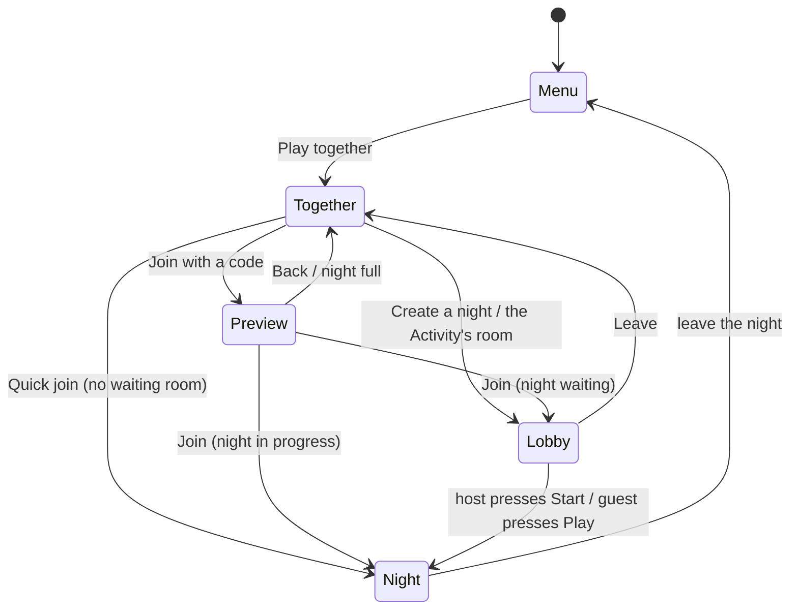

# The lobby

Where friends gather before a night: who is here, who hosts, when it starts, and what a latecomer sees. It answers the
maintainer's questions of 2026-11-02 ("are players able to join mid match, or no?", "it's kind of difficult to know if
players are in your lobby before you start"; Deadnight #515). The platform side (endpoints, expiry) is in
[the platform backend](../research/platform-backend.md#the-lobby-before-the-night); the networking decision is in
[networking](networking.md).

**Status:** built and played in the browser: the backend (open and started lobbies, presence, the round, the
preview by code or by Activity instance), the lobby screen and its poll (`LobbyScreen`, `LobbyWatch`), Play together
opening it, the join notice in the night, and a web probe (`tools/web_smoke/lobby.py`). Not built: the host's match
settings are built too (the host's `MatchSettingsPanel`, sent live with `PUT /lobbies/:id/settings`, read only for
guests).

## The rules in one place

- A **lobby** has a short code, up to **4 seats**, one **host** (the first seat) and a status: **open** (waiting for the
  host) or **started** (a night is running, with a round).
- **Only the host starts.** Guests wait and can leave.
- **Late joining stays on.** A started night takes newcomers while the game server has room (the same 4). The code says
  *Night in progress, round N* before the newcomer presses Join, and Join goes straight in.
- The lobby screen **polls** the backend every 2 seconds. A member who has not polled for a minute has left (a closed
  tab never says so), while someone else is still there; the host role passes on.
- A player never sees an address, an id or a port: only names, seats, a code and a link.

## The flow, screen by screen

### 1. Create a night (the host)

Together has the three ways in it already: *Quick join*, *Create a night*, *Join with the code*. *Create a night* no
longer starts the night. It opens the **lobby** with the player as host:

- The code in large type and the invite link (the web), with *Copy the link* and *Copy the code*.
- **Seats**: four rows, `1 Ann  HOST`, `2 (open)`, `3 (open)`, `4 (open)`. A name is as long as the backend has it
  (guest names, Discord names; #485 will make them the player's own).
- **The night's rules** (`MatchSettingsPanel`, shared with the Play screen): zombie intensity, most alive at once,
  break between rounds. Only the host's panel moves; guests see the same values, read only, as the host sets them.
  A change goes to the backend a third of a second after the host stops (`PUT /lobbies/:id/settings`, one request
  at a time, the last change wins) and reaches the others on their next poll (within two seconds). Start sends the
  panel's values with it, so a change still waiting is never lost. A host who leaves hands the panel on with the
  rules the lobby holds. Once the night starts the panel is read only for everyone (`409 already_started`).
- **Start the night** (primary, focused) and **Leave** (ghost). A line under the seats says what is going on:
  *Waiting for friends. Send them the code.*

### 2. Wait and see members (everyone)

Rows appear and disappear within two seconds of someone joining or leaving. A member whose screen has gone quiet for
15 s shows *(away)*. The status line reads:

- host: *1 of 4 here. Start whenever you are ready.* (Start works alone: it is the old behaviour, one press later);
- guest: *Waiting for Ann to start the night.* Leave is the only button, and the settings are read only.

### 3. Start (the host)

*Start the night* sends the rules (once: they are fixed from then on), the backend allocates a game server, and the host
goes in at once with a ticket. If every server is busy the lobby stays open and says *All the servers are busy. Try
again in a minute.* A guest's poll sees `started`; the status line changes to *Ann started the night* and **Play**
becomes the primary button. A guest presses it (on the web a click is also what lets the page lock the mouse and play
sound, which is why a guest is not walked in without one) and gets a ticket.

### 4. Join late

A friend with a code (typed, or from `?room=CODE`, or the Activity's room) first sees a **preview**, joined to nothing,
which keeps reading the code every two seconds while the screen is open (a waiting room becomes *Night in progress*
by itself):

- *Waiting room, Ann hosting, 2 of 4.* with **Join**;
- *Night in progress, round 4, 2 of 4 here.* with **Join** (a late joiner goes straight into the night);
- *That night is full (4 of 4).* with **Back** only.

Join then adds the player (`join-by-code`) and, for a night in progress, takes a ticket and enters. In the night the
others read *<NAME> JOINED* in the notices under the event feed and see the new row on the scoreboard (Tab).

### 5. Leave

*Leave* on the lobby screen, or Back, tells the backend (`leave`), and the screen returns to Together. A player who
closes the tab is dropped after the minute above. Someone who comes back after being dropped is told *You were away
for too long, so the room moved on* and offered Back, never a silent empty lobby.

### 6. The host leaves

Before the start the next seat becomes host: the rows renumber, the `HOST` mark moves, that player's panel becomes
editable and their button reads *Start the night*, with the line *Ann left. You are the host now.* The last player out
closes the lobby. After the start the host role has no job: the night belongs to the game server.

### 7. A full room

The fifth player gets *That night is full (4 of 4).* at the preview, or, if the room filled between preview and Join,
the same message from the refusal (`409 full`). Nobody is queued: Back, or Create a night of their own.

### 8. In the Discord Activity

The voice channel's room (#495, `ActivityRoom`) is this lobby: the first to press Play together makes it and is the
host, the rest of the channel land in the same lobby (or, if it started, in the preview of a night in progress). The
Activity still opens on the main menu. Joining happens when a player opens the lobby screen, not before, so people who
only opened the Activity are not seats.

## Poll or push

**Polling.** `GET /lobbies/:id` every 2 s while the lobby screen is up, and nothing at other times.

- *Discord's proxy and the web.* A poll is a plain HTTPS request on the path that already works (the `/api` mapping,
  gzip answers, `accept_gzip = false`). A push channel is a second WebSocket through the same proxy, with its own
  reconnection, its own auth and a way to be wrong that polls do not have.
- *Cost.* A lobby has at most 4 members, an answer is about 400 bytes: four screens use 2 requests a second, and a poll
  is also the member's heartbeat, which gives presence for free.
- *Latency.* A join shows within 2 s. For a waiting room that is as good as instant; the start is also seen within 2 s,
  which the guests' *Play* press hides.
- *The way out.* If lobbies ever hold hundreds of waiting players, long polling (the same URL held open until the
  revision changes) cuts the delay without changing the shape. Not needed now.

A background tab stops the game's frames, and with them the polls (a browser throttles hidden pages). A host who goes
to a chat to paste the invite is therefore quiet for a while: the presence window is a minute, and a host who is alone
is never dropped for it (the lobby expires after ten idle minutes, as before).

## What is not in this

- **Quick join** has no waiting room: it puts a stranger in a public night with room, or starts a new one. A public
  waiting room strangers fill up is a separate decision (it needs a countdown or a minimum, and someone to be host).
- **Kicking** a member, **ready** checks and **chat** are not built.
- **Changing the rules after the start** is not possible: they are fixed when the night begins.
