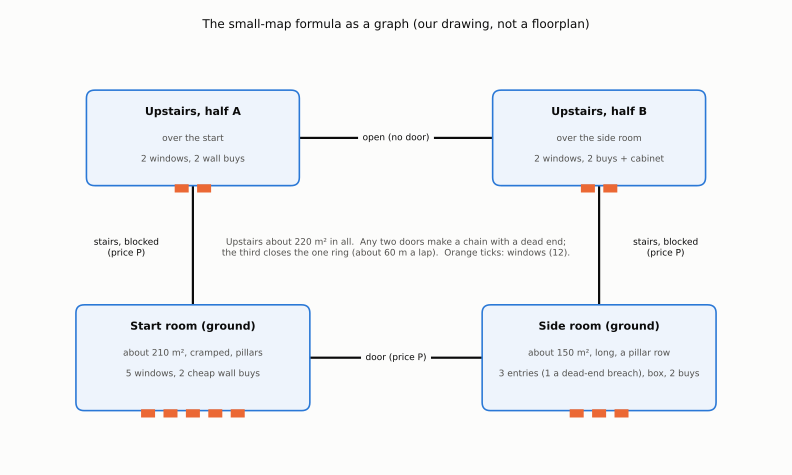

# The small-map formula, from Nacht der Untoten

What a small, tight survival map is made of, measured from the first Call of Duty Zombies map (Nacht der Untoten,
*World at War*, Treyarch, 2008), and the targets Deadnight's second map is built and measured against (#622). The
look and the asset kit are on the sister page, `small-map-art.md` beside this one (#623).

The maintainer's decision (2026-11-02): the floorplan is ours and never a copy; everything else matches Nacht as
closely as the research allows, so it plays like Nacht, and it fits Deadnight's style. Nacht is studied for design and
as visual reference only (the kit's rule on original work): its layout, names, writing and assets are never copied.
So this page gives numbers and rules, and its diagrams are our own drawings of a graph, not a floorplan.

## How to read the numbers

Each number is marked: **W** a wiki or guide states it (sources at the end, read through the wiki's own interface or
fetched), **D** read from a game's script as quoted by a community thread, **E** our estimate from the maintainer's 15
reference captures and two community floorplans (kept in `refs/deadnight/nacht-der-untoten/`, never committed), with
its basis, **M** measured by us in Deadnight's greybox. No video was watched; the captures stood in for them.

### The scale of the estimates (E)

Nobody publishes Nacht's size: no wiki, guide or recreation states it, and the map's source was never released. The
two floorplans (a fan drawing of each floor, downstairs and upstairs, with walls, windows, pillars and stairs) are to
an unknown scale, so one length was measured in a capture and carried to the plan:

- **The spawn capture.** The player stands at the start room's centre and looks level at its window wall (the window
  bars are parallel, so the view has no pitch). With the engine's 1.52 m eye (60 units at an inch a unit) and its 65
  degree field of view on a 4:3 frame, the wall's foot sits 221 px below the horizon: `1.52 x 804 / 221 = 5.5 m` to
  the wall. On the plan that is half the room's depth (114 px), so a plan pixel is 0.10 m.
- **Checks.** At that scale the start room's pillar bays are 4.1 m by 3.0 m, and a zombie across the start room in
  another capture (85 px tall at 16:9) stands about 16 m away, against 20 m for the room's long axis; both agree. The
  wall top in the spawn capture puts the ceiling at 3.3 m. The stair treads on the plans do not agree (drawn about
  twice as deep as real treads), so they were not used.
- **Error.** About 20% either way. Every Nacht area below carries that error; the targets' tolerances are on top.

## Nacht at a glance

Three rooms on two floors, three paid ways between them, twelve windows, one Mystery Box that never moves, eight
wall weapons and a sniper cabinet, and nothing else: no perks, no power, no Pack-a-Punch, no traps but explosive
barrels outside, no hellhounds (W). It was hidden in *World at War* as a reward for finishing the campaign, built
inside the bunker of the campaign mission and multiplayer map Airfield (W). Its internal name is
`nazi_zombie_prototype` (W).

| | Value | Mark |
| --- | --- | --- |
| Rooms | 3: the start room, the "Help" room, the upstairs (one floor split in two halves joined by an opening) | W |
| Floors | 2 | W, E |
| Windows (barriers) | start 5, Help room 3 (two windows and a wall onto a dead-end cave), upstairs 4: 12 | W |
| Paid ways | 3, all 1000 points: the Help door, the debris on the start room's stairs, the debris on the Help room's stairs | W |
| Starting points, weapon | 500 points; M1911 pistol, knife, two grenades | W |
| Mystery Box | 950 points, in the Help room's far corner, never moves (it moves from the next map on) | W |
| Wall weapons | start: 200 and 600; Help room: 1200 and 1200; upstairs: 250 (grenades), 1200, 1500, 1800 and the sniper cabinet at 1500 | W |
| Power-ups | Max Ammo, Insta-Kill, Double Points, Nuke (Carpenter added in the *Black Ops* port) | W |
| Players | 1 to 8, all spawning in the start room | W |
| Zombie health | 150, +100 a round to 950 at round 9, then x1.1 a round | W ([round scaling](../round-scaling.md)) |
| Zombies a round, at once | a concurrent cap of 24; on solo the maps before Der Riese stop at 24 a round | W |
| Repair | 10 points a board, capped per round | W |

## Size and scale

Measured on the plans at 0.10 m a pixel (E, about 20%). Areas are floor inside the walls, pillars and stairs included.

| Room | Size | Floor | Ceiling | Pillars | Windows | Wall buys |
| --- | --- | ---: | ---: | --- | ---: | --- |
| Start room | a 11.7 x 11.4 m block and an 8.5 x 8.9 m annex | 209 m² | 3.3 m | 6, in a 2 x 3 grid, bays 4.1 x 3.0 m | 5 | 2 cheap |
| Help room | 6.9 x 20.8 m, a stair bay of 1.9 x 5.1 m | 153 m² | about 3.3 m | 4, in one row, 3.1 and 3.8 m from the walls | 3 | 2 mid, and the box |
| Stair hall | 11.1 x 2.3 m | 25 m² | | | 0 | |
| Upstairs, over the Help room | 6.9 x 18.2 m and its stair bay | 136 m² | | 4 and a long beam | 2 to 3 | 2 and the cabinet |
| Upstairs, over the start room | 11.7 x 8.8 m less the open stairwell | 83 m² | | 2 | 1 to 2 | 2 |
| **Inside, in all** | ground floor in a 29 x 21 m box | **about 600 m²** | | | **12** | **8 and the cabinet** |

The wikis agree with the shape of this: the start room is "fairly large", the Help room "slightly smaller", and the
upstairs "the largest playable area" with "a lot of rubble and debris laying around, limiting maneuverability" (W).

Against our lot (M: the floor rectangles of `game/tools/lot/lot_report.gd`, and the zombies' baked mesh inside the
lot's bounds), all of Nacht would fit inside the drive-in's field 10 times over:

`tools/docs/small_map_figures.py` draws this figure and the graph below.

## Topology

Nacht is **one ring of three rooms**. The start room links to the Help room by a door and to the upstairs by a
stair; the Help room links to the upstairs by its own stair; the two halves of the upstairs are open to each other.
Each of the three links is paid (W). Whichever two a team buys first, the map is a chain with a dead end at its far
room; the third closes the ring. There is no second ring and no room that is not on it (W, from the room list).

- **Dead ends.** The Help room's cave is a barrier that leads nowhere: zombies come out of it, players cannot go in
  (W). Before the ring closes, the room bought last is a dead end.
- **Loops (E).** The start room's pillar grid makes a loop of about 30 m around it; the Help room's pillar row
  another of about 30 m; with all three links the ring is about 60 m a lap (start room, stairs, upstairs, the Help
  room's stairs, the Help room, the door). Every loop passes windows, so new zombies join a train from the side.
- **Holdouts.** The upstairs with one or both stairs left closed is the classic hold: four windows and at most one
  stair (W: "Should the player wish to camp here, it is a good idea to leave the sofa barricade ... closed"). Corners
  behind sandbags upstairs see one or two windows (E, from the captures). Two players holding the Help room and the
  start room with both stairs closed found it "useless at around round 10" (reported: a forum thread we could not open,
  read only in a search summary).
- **Traps.** Nowhere is a pocket with no way out once the ring is open; before it is, the far room of the chain is
  one (E).

| Holdout | Entries to watch | Directions (walls with an entry) | Mark |
| --- | --- | ---: | --- |
| Start room, from the middle | 5 windows, and the door and the stair once bought | 3 | W, E |
| Help room | 2 windows and the cave, and the door and the stair once bought | 3 | W, E |
| Upstairs, stairs closed | 4 windows | 2 | W, E |
| Upstairs, one stair open | 4 windows and a stair | 3 | W, E |

## Zombie entry

- **Windows.** 12 boarded windows (5, 3, 4), each torn board by board and repaired for 10 points a board (W). The
  dead come to a window from outside and only enter through one: the building has no other way in (W, E).
- **Spawn distance (E).** At the start, a player at the room's centre is 5.5 m from the nearest window (the scale
  measurement above). The zombies appear in the fenced yard outside, 5 to 15 m beyond a window (the captures show the
  fence about that far). So the first zombie of a round is about 10 to 20 m from a player, and reaches a window in a
  few seconds.
- **The cave.** The Help room's third barrier spawns behind a wall; in *World at War* nothing spawns there until
  round 5 if the room was opened earlier (W).

## Economy and placement

- **The door curve is flat.** All three ways cost 1000, twice the starting 500, and the box costs 950 (W). The order
  the team opens the map is its choice, not the price's.
- **Weapons climb with risk.** The start room sells the two cheapest (200 and 600, a fifth and three fifths of a
  door), the Help room two at 1200 (1.2 doors) beside the box, the upstairs the dearest (1500 and 1800, 1.5 and 1.8
  doors), the grenades (250) and the sniper cabinet (1500, a scoped rifle) (W). The better gun is always one bought
  room further from the start.
- **The box is the only gamble,** one paid room from the start, in the room that is a dead end until the ring closes
  (W). It never moves in *World at War* (W), so its corner is a known place to fight from.
- **What it leaves out, and why it works.** No perks, no power, no Pack-a-Punch: the only things to work towards are
  the doors, the box and the walls (W: "Access to the Mystery Box is typically the only goal"). Critics read that as
  the point: "one primary gameplay focus" (Germain), "the great limitations it forces on players" (Push Square). The
  cost is the ceiling: "hard to push 20 ... since there are only wall buys and the Mystery Box" (Push Square).

When the doors fall due, by the same count as our lot's affordability column ([the lot](../../design/map.md#areas-and-opening-order):
one player, half the points on doors, no starting points or round bonus): Nacht's solo counts (6, 8, 13, 18, 24: W) at
about 100 points a zombie (a torso kill of 60 and four hits of 10: W) give 300, 700, 1350, 2250 and 3450 by the end
of rounds 1 to 5. **One door at round 3, two at round 4, all three at round 5** (E).

## Pacing

- **Rounds.** The health curve is the wiki's (above); the count stops at 24 a round on solo, so a solo round's
  difficulty from round 6 on is all health (W). [Round scaling](../round-scaling.md) has the curves beside ours.
- **How far players get.** Push Square found it "hard to push 20" on Nacht against 25 to 30 on later maps.
- **Why late rounds are hard (E).** The weapons stop improving (the best wall gun is upstairs, the box is a gamble),
  health grows 10% a round, and every loop runs past windows, so a train picks up the new arrivals instead of
  leaving them behind. A held corner fails when one window more is torn than the holder can cover.
- **How long a game lasts (E).** A solo round of 24 at the script's base spawn delay of 2 s (D, a later game's script
  value) takes at least 50 s; with the walk in and the kills, rounds 10 to 20 run one to three minutes, so a
  round-20 game is about 40 to 60 minutes.
- **The small space is the pressure.** At most 24 dead in 600 m² is one zombie to 25 m² of floor; in the start room
  (209 m²) a full crowd stands one to every 9 m² (E).

## Sightlines and verticality

- **Short lines.** The longest indoor line is a room's long axis, about 20 m (the Help room and the start room with
  its annex); a held corner sees 10 to 15 m (E). Nothing is seen from far off: the dead arrive at a window, already
  close.
- **One floor up.** The upstairs is about 3.6 to 3.8 m above the ground floor (a 3.3 m ceiling and the slab, E),
  reached by two stairs, one from each ground room, each blocked by debris until bought (W). Upstairs has "a slight
  elevation advantage" (W): its windows look down on the yard the dead cross (a capture shows the view over a sandbag
  line by the stairs).
- **Sandbag lines.** Low sandbag walls and furniture stand in front of windows and on the stairs' landings: cover for
  the holder and an obstacle for a train (E, from the captures).

## Mood and story

Kept short here; the look is on `small-map-art.md` (#623).

- **Light.** Outside, a pale moon through fog over snow, nearly colourless; inside, dark rooms with pools of light
  under a few hanging lamps, and moonlight through the windows. The fog hides the approach, "makes their eventual
  arrival far scarier" (Germain).
- **Sound.** No score during a round (E): a chime at a round's start and end, zombie voices outside, a radio in the Help
  room that plays a song when shot, and a song at game over (W).
- **The story the space tells.** A crashed bomber and destroyed trucks outside; inside, the barricades and sandbags of
  people who held out before, and chalk writing on the walls and doors that points the way up (W). There are no
  named characters and no quest in the original (W): the place and its scrawls are the whole story.

## Why it is loved, its faults, and the remakes

- **Loved for** its single focus, the replay pull ("you were sure you could get to the next level if you could play
  it again", Treyarch's Mark Lamia), the tension of the fog and the small space, and being the first (Lamia; Germain;
  Push Square). It began as a small team's side project during *World at War*'s crunch, "one of the pet projects of
  one of the designers", seeded by tower-defence games (Daniel Suarez, executive producer, via PSU).
- **Faults.** A low ceiling of rounds with only wall weapons and the box; camping beats moving once a player knows the
  corners ("finding spots to hold out in for the remainder of a session", Push Square). The rubble upstairs limits
  movement on purpose.
- **The remakes added what Nacht left out.** *Black Ops* (2010): newer weapons, the Thundergun and Monkey Bombs in
  the box, the Carpenter power-up, a perk (Mule Kick) by patch, named characters, a hidden song (W). *Black Ops III*'s
  Zombies Chronicles (2017): rebuilt art with volumetric light and fog, a perk machine that sells any perk, gum
  machines, the Death Machine power-up, more hidden songs (W; Push Square: "a bit easier and less exciting"). *Black
  Ops II* placed a ruined copy as a hidden spot inside a larger map, and *Black Ops Cold War*'s Die Maschine (2020)
  made the bunker the centre of a much larger map (W). Each later version made it easier or bigger; none changed the
  three rooms.

## The formula: hard targets for our map

The maintainer asked for hard targets, not guidance. The greybox of the second map (#631) is measured against every
row, and its gameplay setup (#632) against rows 20 to 26; a row it misses is a bug, or a decision recorded here. The
tolerance is around Nacht's estimate, which itself carries about 20%; where a row is a count, it is exact. Deadnight's
style adds the last block.

### Size and shape targets

| # | Target | Nacht | Tolerance | Measured in the greybox as |
| ---: | --- | --- | --- | --- |
| 1 | Total floor inside, all doors open | 600 m² (E) | 540 to 660 m² | the player's walking mesh inside the building, both floors |
| 2 | Floors | 2 | exact | |
| 3 | Rooms | 3: start, side room, upstairs (in two halves joined by an opening with no door) | exact | |
| 4 | Start room floor | 209 m² (E) | 188 to 230 m² | its walking mesh |
| 5 | Side room floor | 153 m² (E) | 138 to 168 m² | its walking mesh |
| 6 | Upstairs floor | 219 m² (E) | 197 to 241 m², the largest area | its walking mesh |
| 7 | The side room is long and narrow | 6.9 x 20.8 m (E) | length at least 2.5 times width, width 6 to 8 m | its floor rectangle |
| 8 | The start room is cramped: pillars that make a loop | 6 pillars, bays 3 to 4 m (E) | a pillar group with a 25 to 36 m loop round it | path length on the mesh |
| 9 | Ceiling | 3.3 m (E) | 3.0 to 3.6 m | the floor-to-ceiling of each room |
| 10 | Longest sight line indoors | 20 m (E) | 16 to 24 m | the longest clear ray at eye height |

### Topology and entry targets

| # | Target | Nacht | Tolerance | Measured as |
| ---: | --- | --- | --- | --- |
| 11 | Paid links | 3: start to side room (a door), start to upstairs (a stair), side room to upstairs (a stair) | exact | the door groups |
| 12 | One ring, closed by the third link; any two links leave a chain with a dead end | as Nacht (W) | exact | reachability per set of sold links |
| 13 | The ring's lap | 60 m (E) | 48 to 72 m | path length on the mesh |
| 14 | A loop of its own in the side room (a pillar row) | 30 m (E) | 25 to 36 m | path length |
| 15 | Windows | start 5, side room 3 (one of them a dead-end breach the dead come out of), upstairs 4 with at least one in each half | exact; on our map **start 2, side room 2 (one a breach), upstairs 2, both over the start room**, the maintainer's rule of 2026-11-03 (#917), the side room's third dropped for the use zones' spacing (#994) | the barricades and their rooms |
| 16 | Directions to watch from each room's middle | start 3, side 3, upstairs 2 with the stairs closed (W, E) | exact | walls with an entry |
| 17 | Players' start to the nearest window | 5.5 m (E) | 4 to 7 m | from the spawn markers' centre |
| 18 | A window's spawn outside it | 5 to 15 m (E) | 5 to 15 m, never inside, on the yard's ground; its dead come in by their own window and reach their own room only | from each spawn to its window; the way from it to the floor inside its window passes through that window |
| 19 | Stairs | two, one from each ground room, blocked until bought, rising 3.6 to 3.8 m (E) | exact count; rise 3.3 to 4.0 m | |

### Economy and placement targets

| # | Target | Nacht | Tolerance | Measured as |
| ---: | --- | --- | --- | --- |
| 20 | Every link costs the same price P | 1000 = 2 x start points (W) | equal, exact | the shop's tuning |
| 21 | P opens one link at round 3, two at round 4, three at round 5, solo | rounds 3, 4, 5 (E) | each within one round | `test_door_affordability.gd`'s count |
| 22 | The box: one place, never moves, in the side room | Help room corner, 950 (W) | exact; price 0.85 to 1.05 P | the crane's places |
| 23 | Wall weapons: 2 in the start room, 2 in the side room, 4 and a cabinet upstairs | 2, 2, 4 + 1 (W) | exact counts | the shop spots |
| 24 | Wall prices climb with distance from the start | start 0.2 and 0.6 P, side 1.2 P, upstairs 1.2 to 1.8 P (W) | each within 10% of its ratio | the shop's tuning |
| 25 | Every map carries the machines: the soda fountain, the perk coolers, the re-cut bench and the prize crane (our box) | Nacht has none of the first three (W); ours keep all four, **the maintainer's decision of 2026-11-03 (#859)** | exact: one fountain, one cooler for each other tonic, one bench, a crane place | `test_map_machines.gd`, over the picker's list |
| 26 | At most 24 dead at once on this map | 24 (W) | exact | the map's alive cap |

With today's tuning (85 points a zombie, the solo counts 4, 5, 7, 9, 10: [the lot](../../design/map.md)), half of a
player's points reach 170, 382, 680, 1062 and 1487 by the end of rounds 1 to 5, so row 21 holds for **P from 400 to
475**; 450 is the middle. That is 2.25 times our 200 starting points, close to Nacht's 2.0.

### Deadnight's style on top

| # | Target | Why |
| ---: | --- | --- |
| 27 | Every passage the camera goes through is at least 1.8 m wide, doors 2.0 m | the shoulder camera ([the lot](../../design/map.md#widths-and-the-camera)); Nacht's doors are narrower, and the camera wins, inside rows 1 to 6 |
| 28 | The camera probes of the lot (`CameraProbes`) at every door, stair and corner | the same test as the lot |
| 29 | The setting is Deadnight's 1958 world, not a 1945 bunker: no German writing, no war wreck, no names from Nacht | original work |
| 30 | Light is ours: the maintainer decides whether the generator and circuits come along (the machines are decided: row 25) | light is Deadnight's first pillar; Nacht has no power |

### Measured in the greybox (M)

The greybox (#631, [the second map](../../design/smallmap.md)) holds every row from 1 to 19 and 27 to 29; the table
of measured values is on its page, and `test_smallmap_formula.gd` fails a row that drifts out. The numbers it
measured: 585 m² inside (start 205, side 151, upstairs 228), the ring's lap 68 m, the loops 29 and 31 m, the longest
sight line 23 m, 3.2 m ceilings, a 3.4 m rise, X, spawns 6 to 7 m outside. After the rework of the outside and the
windows (#917): 578 m² (start 200, side 150, upstairs 217), the lap 68 m, windows 2 / 3 / 2, spawns 7 to 14.8 m out.
After the use zones were spaced (#994): windows 2 / 2 / 2, the side room's south-west window gone.

**Windows that make sense (the maintainer's decision, 2026-11-03, #917).** Row 15's counts are Nacht's; on our map the
maintainer ruled that the ground floor has one window a wall and the upstairs a few, each reached by the dead walking up
outside stairs onto a deck, and that a map's layout must make sense to a player. So the hall has two (its third outside
wall is the shop wall, with the outside stair beyond it), the side room two (the breach at its west end and a window at
its north-east; a third in its south-west corner shared the breach's corner and the Swift Rescue alcove's ground, #994)
and the upstairs two, both over the hall (a window of the other half on the same deck would join the halves outside by a
shorter way than the opening, and a bot would take it). Row 18 still asks that each room's dead reach that room only,
now with the ground at one level: the yard is walled into a front yard, an alley with the outside stair and a back yard
(a bank at the upper floor's height had made it hold before, and read as two grounds); and it asks that the dead come in
by their own window.

### Measured in the setup (M)

The setup of the second map (#632, [Playing it](../../design/smallmap.md#playing-it-links-windows-buys-and-the-box))
holds rows 20 to 26; `test_smallmap_economy.gd` fails a row that drifts out of its tolerance, and recomputes row 21
from the tuning instead of trusting a typed number:

| # | Target | Set to |
| ---: | --- | --- |
| 20 | Every link costs the same price P | 450 for all three (2.25 times the 200 starting points) |
| 21 | One link at round 3, two at 4, three at 5 | 3, 4 and 5 by the count above (P may be 400 to 475) |
| 22 | The box: one place, never moves, in the side room, 0.85 to 1.05 P | one place in the side room, no breakdown at any count, 425 (0.94 P) |
| 23 | Wall weapons 2, 2, 4 and a cabinet | 2 in the hall, 2 in the side room, 4 and the cabinet upstairs (the shotgun on two walls: eight weapons make nine places) |
| 24 | Prices climb with the distance, each within 10% | 0.2 and 0.6 P in the hall, 1.2 P in the side room, 1.2 to 1.6 P on the walls upstairs and 1.5 P for the cabinet |
| 25 | Every map carries the machines | links, weapons, the box and ammunition, and (#792) the soda fountain, five perk coolers and the re-cut bench at the shared prices ([the machines](../../design/smallmap.md#machines)); `test_map_machines.gd` fails a map of the picker's list without one |
| 26 | At most 24 dead at once | 24, whatever the round and the party, on a desktop and in the browser |

**What it leaves out (row 30), asked of the maintainer.** The setup first followed Nacht and sold no tonics or re-cut;
issue 792 then brought the lot's re-cut bench, soda fountain and perk coolers to this map, and the maintainer ruled on
2026-11-03 (#859) that this was right and the formula wrong: **every map has the soda fountain, the perks, the re-cut
bench and the prize crane** (row 25, [the design page](../../design/smallmap.md#machines)). Still open is the power:
no generator, circuits or fuel cans on this map, the lamps always lit; the answer the maintainer gives goes here:
*(open for the generator)*. If light is to matter on this map the choices are the generator with one
circuit a room, or the whole map on one circuit; either is one more row in the map's tuning and the markers in its scene.

Two of this page's rows overrule the kit's sizes on [the art page](small-map-art.md), and the greybox follows the
rows: the ceiling (row 9) and the rise (row 19) make the storey 3.4 m, not the kit's 3.0 m; and row 27 makes the
paid door, the upstairs opening and the stairs 2.0 m wide, not the kit's 1.4 m.

## Nacht against the drive-in lot

| | Nacht (E unless W) | Drive-in lot (M unless noted) | Ratio |
| --- | --- | --- | ---: |
| Floor in all | about 600 m² | 13,100 m² of floor rectangles; 10,500 m² of zombie mesh inside its bounds | 22 |
| Footprint | 29 x 21 m ground floor | 124 x 116 m | 24 by area |
| Start area | 209 m² | the field, 5,952 m² | 28 |
| Floors | 2 | 1, and the booth's upper room | |
| Rooms or areas | 3 | 7 | |
| Ceiling | 3.3 m | open sky | |
| Windows or breaches | 12, in every room | 6, all in the field | |
| Paid links | 3, all 1000 | 5: 350, 500, 750, 1250, 2000 | |
| Door price over starting points | 2.0 | 1.75 to 10 | |
| Doors affordable, solo (half the points) | rounds 3, 4, 5 | rounds 2, 4, 6, 8, 10 | |
| Start to the nearest window or breach | 5.5 m | 37 m | 7 |
| Spawn distance from a player at the start | 10 to 20 m | 38 to 69 m (the field's six spawns) | 4 |
| Longest sight line | about 20 m | 70 m (the booth window) | 3.5 |
| Shortest loop | about 30 m | 45 m (round the counter) | 1.5 |
| The big loop | about 60 m | 110 to 120 m | 2 |
| Wall weapons | 8 and a cabinet | 2 | |
| Random weapon | the box, one fixed place, 950 | the crane, four places, 550 | |
| Other things to buy | none | fuel, tonics, the re-cut, grenades, ammunition (the tonics, the re-cut and the crane on every map, row 25) | |
| Most dead at once | 24 | 6 to 40 by round and party | |
| Floor a zombie at the cap | 25 m² | 330 m² (40 on 13,100 m²) | 13 |

## What our map takes, and what it never takes

- **Takes:** the numbers and rules of the formula above: the area, the rooms and their sizes, the ring and its
  links, the window counts, the flat door price, the box in the side room, the climb of wall prices, the short
  distances, the low ceiling and the one floor up.
- **Keeps from Deadnight, on every map:** the soda fountain, the perk coolers, the re-cut bench and the prize crane
  (row 25), though Nacht has no perks and no upgrade; the formula follows Nacht for the floorplan and the numbers, and
  these four are the game's, not a thing to take away from a map.
- **Never takes:** Nacht's floorplan or the shape of any room, its names ("Help", the cave), its wall writing, the
  bomber, the bunker, its weapons and their names, its textures, models or sounds. The map's shapes, setting and story
  are Deadnight's; the follow-up issues ask for an original layout that hits the formula.

## Sources

Read: the page's text through the wiki's own interface or a fetch. Reported: only a search summary was seen.

- **W** Call of Duty Wiki, [Nacht der Untoten](https://callofduty.fandom.com/wiki/Nacht_der_Untoten) (read): rooms,
  windows, doors, prices, box, setting, internal name, versions, trivia, music.
- **W** Call of Duty Wiki, [Nacht der Untoten (location)](https://callofduty.fandom.com/wiki/Nacht_der_Untoten_(location))
  (read): the rooms, the reappearances in *Black Ops II*, Revelations and Die Maschine.
- **W** Call of Duty Zombies Wiki, [Nacht der Untoten](https://callofdutyzombies.fandom.com/wiki/Nacht_der_Untoten)
  (read): starting points and weapons, rooms ("the largest and most open room"), power-ups.
- **W** Call of Duty Wiki, [Mystery Box](https://callofduty.fandom.com/wiki/Mystery_Box),
  [Sniper Cabinet](https://callofduty.fandom.com/wiki/Sniper_Cabinet), [Zombie](https://callofduty.fandom.com/wiki/Zombie)
  (health), [Zombies (Treyarch)](https://callofduty.fandom.com/wiki/Zombies_(Treyarch)) (the count and the cap of 24),
  [Points (Zombies)](https://callofduty.fandom.com/wiki/Points_(Zombies)),
  [Zombies Chronicles](https://callofduty.fandom.com/wiki/Zombies_Chronicles),
  [Die Maschine](https://callofduty.fandom.com/wiki/Die_Maschine) (all read).
- **W** Gameranx, [Nacht der Untoten walkthrough, Zombies Chronicles](https://gameranx.com/features/id/106913/article/call-of-duty-black-ops-3-zombie-chronicles-nacht-der-untoten-map-walkthrough-map-guide/)
  (2017, read): 5, 3 and 4 barriers; the box in the Help room.
- **D** UGX-Mods, [How to change the max amount of zombies per round](https://www.ugx-mods.com/forum/scripting/87/how-to-change-the-max-amount-of-zombies-that-spawn-per-round/13967/)
  (2016, read): `zombie_spawn_delay` 2.0, `zombie_max_ai` 24, `zombie_ai_per_player` 6, quoted from a later game's
  script.
- Jack Hanke, [The Math of COD Zombies](https://jackhanke.github.io/posts/zombies) (read): the solo counts of rounds 1
  to 9 (6, 8, 13, 18, 24, ...).
- L. Willcocks and M. Inch, [How Many Rounds Would it Take to Complete Call of Duty: World at War Nazi Zombies?](https://journals.le.ac.uk/index.php/jist/article/download/724/676/1480),
  Journal of Interdisciplinary Science Topics, 2017 (read): counts plateau near 28 from round 5 to 9, measured on
  Der Riese.
- GamesBeat, [How zombies forever changed Call of Duty developer Treyarch](https://gamesbeat.com/how-zombies-forever-changed-call-of-duty-developer-treyarch/)
  (2015, Mark Lamia at DICE, read).
- PlayStation Universe, [What inspired Nazi Zombies in CoD World at War](https://www.psu.com/news/what-inspired-nazi-zombies-in-cod-world-at-war/)
  (2008, Daniel Suarez via MTV, read).
- Push Square, [Zombies Chronicles review](https://www.pushsquare.com/reviews/ps4/call_of_duty_black_ops_iii_zombies_chronicles)
  (Joey Thurmond, 2017, read).
- Toni Germain, [A case for Call of Duty Zombies smaller maps](https://fish-error.pages.dev/posts/a-case-for-call-of-duty-zombies-smaller-maps)
  (2023, read).
- CallofDutyZombies.com, [Nacht der Untoten 2 player strategy](https://callofdutyzombies.com/topic/143424-nacht-der-untoten-2-player-strategy)
  (reported: the page answered with a server error; one line seen in a search summary).
- Not readable by our tools: GameSpot's oral history of Zombies (403) and two GamesRadar features (no text came back).
- The maintainer's 15 captures and the two floorplans in `refs/deadnight/nacht-der-untoten/`: the World at War
  originals, one from the *Black Ops* port (the sniper cabinet) and three from the Chronicles remake (the "Help" door,
  the upstairs corner, the outside). They are for study and stay out of the repository.
